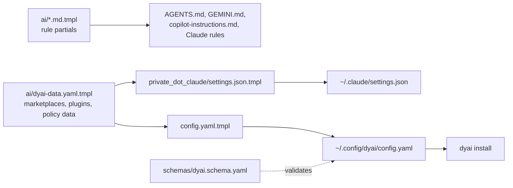

# dyai: idea and architecture

This note explains why `dyai` exists, how its parts fit together, and how
each command works, as of branch `crew` (2026-10-27). It is the overview;
[`dyai.md`](dyai.md) is the reference for commands and config keys. A
Vietnamese version is in [`dyai-architecture.vi.md`](dyai-architecture.vi.md).

Status of the pieces described here:

| Part | State |
|---|---|
| Baseline install, per-project presets, `dyai mcp`, LSP sharing | merged into `main` |
| Hardening: time limits, local-edit protection, model tiers, `dyai status`, `dyai enforcement`, subagent spawn log | built on `crew` |
| Crew: run, review, fix and merge tasks across agent CLIs, lean workers, crew MCP tools, `selftest`, `eval` | built on `crew` ([plan](superpowers/plans/2026-10-26-dyai-crew.md)), reviewed, not merged |
| Subagents for Gemini, opencode and Copilot; `dyai update` (skills by hash); routing gate; zellij views | built on `crew` |

<!-- toc -->

- [The idea](#the-idea)
- [Three layers of config](#three-layers-of-config)
- [Where the config comes from](#where-the-config-comes-from)
- [Commands](#commands)
- [`dyai install`: the baseline](#dyai-install-the-baseline)
  - [One concept, seven dialects](#one-concept-seven-dialects)
- [`dyai use`: per-project presets](#dyai-use-per-project-presets)
- [Runtime pieces every session shares](#runtime-pieces-every-session-shares)
- [Honesty: what dyai checks about itself](#honesty-what-dyai-checks-about-itself)
- [Crew: several agents on one task](#crew-several-agents-on-one-task)
- [What the final review found and fixed](#what-the-final-review-found-and-fixed)
- [Open points](#open-points)
- [File map](#file-map)
- [Tests](#tests)

<!-- tocstop -->

## The idea

This machine runs seven AI-agent CLIs: Claude Code, Codex, Gemini CLI,
opencode, GitHub Copilot CLI, Antigravity (`agy`) and Hermes. Each one has its
own way to declare skills, subagents, MCP servers, plugins, hooks and
permissions, in its own file format and its own directory. Kept by hand, they
drift: a rule added to Claude never reaches Codex, an MCP server works in one
agent and is missing in the next, a skill is installed twice.

`dyai` treats agent extensions the way `mise` treats tools:

- **One declarative config** describes what every agent should have.
- **`dyai install` converges** each installed agent onto it. It is idempotent:
  run it again and nothing changes. An agent whose CLI is absent is skipped.
- **A small global baseline** loads into every session; everything
  domain-specific lives in a **registry of presets** that a project opts into
  with `dyai use <name>`. Context is a budget: every global skill description
  and MCP tool definition is paid for in every session.
- **Personal by default.** Per-project choices are written to git's personal
  ignore (`.git/info/exclude`), never to a committed file, so they never reach
  the team.
- **Translate, don't copy.** dyai keeps one concept (a deny rule, a stop
  hook, an MCP server) and writes it into each agent's own mechanism. Where an
  agent has no such mechanism, dyai says so instead of pretending.

## Three layers of config

```text
~/.config/dyai/config.yaml
├── global        baseline for every agent, every project
│   ├── skills        skills.sh entries (cross-cutting only)
│   ├── subagents     pinned repo + categories, optional exclude and models
│   ├── commands      pinned repos of command .md files (presets name them)
│   ├── mcp           servers, written into every MCP-capable agent
│   ├── hooks         abstract events: stop, input
│   ├── installers    one shell command per agent id, run once per hash
│   ├── policy        permissions (Claude syntax), approval mode, theme, effort
│   ├── lsp           which Neovim language servers to share, serena pin
│   └── crew          fallback, reviewer, model, timeout, fences, gate, profile, panes
├── agents.<name> things only one agent understands
│   └── claude        marketplaces, plugins, optional_plugins, model_tiers
└── registry      opt-in presets: languages, infra, presets
                  each {subagents?, skills?, mcp?, commands?, plugins?}
```

A project adds a fourth, personal layer: `.dyai.toml` at the repository root,
holding `use = [...]` (chosen presets) and the manifest of files dyai wrote
for them.

## Where the config comes from

Everything is rendered by chezmoi from this repository:



- `home/.chezmoitemplates/ai/dyai-data.yaml.tmpl` is data only. Both the dyai
  config and Claude's `settings.json` render from it, so the two never drift.
- `schemas/dyai.schema.yaml` validates the rendered config
  (`additionalProperties: false` throughout).
- The machine-wide agent rules (credentials, destructive commands, intent,
  verification, …) are separate partials in `home/.chezmoitemplates/ai/`,
  rendered into each agent's instruction file. They are the soft half of the
  policy; `global.policy.permissions` is the half a harness can enforce.
- `home/.chezmoiscripts/run_onchange_after_03-setup-ai.sh.tmpl` runs
  `dyai install` on `chezmoi apply` when the inputs change.

## Commands

| Command | Scope | What it does |
|---|---|---|
| `dyai install` | machine | Converge every installed agent onto `global` and `agents.*` |
| `dyai use <name>` | project | Record a preset in `.dyai.toml` and materialize it |
| `dyai ls` | project | Print the baseline, the registry and this project's presets |
| `dyai rm <name>` | project | Drop a preset and prune exactly the files it owned |
| `dyai mcp` | session | Serve `ls`, `use`, `rm` and the crew tools as MCP tools on stdio |
| `dyai status [--quiet]` | machine | Report drift between the config and each agent |
| `dyai enforcement` | — | Print what each agent actually enforces |
| `dyai update [--check]` | machine | Update installed skills whose upstream changed; keep local edits |
| `dyai run`, `tasks`, `logs`, `review`, `fix`, `merge`, `drop` | repository | The crew (below) |
| `dyai selftest [AGENT...]`, `dyai eval` | machine | Live checks of the policy and the agent rules (spend quota) |

Options always come before the positional argument (`dyai review --by
copilot ID`): the dybatpho parser stops reading options at the first one.

The CLI is `home/dot_local/bin/executable_dyai.tmpl`, a thin dybatpho
`opts` front end. The logic lives in sourced libraries under `scripts/lib/`,
each with a bats file under `scripts/test/`.

## `dyai install`: the baseline

`dyai::install` needs `jq`, `yq` and the config, then runs these steps in
order. A step that fails warns and the install carries on; one broken item
never stops the rest.

1. **LSP** (`dyai_lsp::setup`): export Neovim's configured language servers
   into a manifest and hand them to every agent (see below). It runs first
   because it registers the local `dyai-lsp` marketplace that step 3 installs
   from.
2. **Marketplaces** (Claude): `claude plugin marketplace add` for each one
   not yet known.
3. **Plugins** (Claude): `claude plugin install` for each one not in
   `installed_plugins.json`. `optional_plugins` install too but stay switched
   off in `settings.json` until a preset turns them on.
4. **MCP**: each `global.mcp` server is written into every MCP-capable agent
   in its own format (`claude mcp add-json` across every Claude config
   directory, JSON merges for Gemini/agy/Copilot/opencode, TOML for Codex,
   YAML for Hermes). Claude skips a server that an enabled plugin of the same
   name already bundles. `env` holds variable names, never values.
5. **Gemini baseline**: fixed settings (schema, context file names,
   checkpointing, telemetry off, `security.disableYoloMode`).
6. **Policy**: the approval mode (`accept-edits`) mapped per agent.
7. **Permissions**: `Bash(...)`, `Read(...)`, `Edit(...)` rules translated
   per agent (table below).
8. **Hooks**: the abstract `stop` and `input` events written as Gemini
   `AfterAgent`, Copilot `hooks/dyai.json`, Codex `hooks.Stop`, and so on.
9. **Subagents**: the pinned VoltAgent categories copied into
   `~/.claude/agents`, converted to TOML for `~/.codex/agents` (an agent with
   no writing tool runs `read-only` there), and to Markdown agents for Gemini
   (`~/.gemini/agents`), opencode (`~/.config/opencode/agents`) and Copilot
   (`~/.copilot/agents/*.agent.md`). Files dyai no longer wants are removed
   only when they still match the hash dyai recorded.
10. **Skills**: `skills add <entry> -g` for each missing global skill.
11. **Installers**: each `global.installers` command, once per content hash.

Every external command in steps 2, 3, 10 and 11 goes through
`dyai::run_external`: stdin closed, killed after `DYAI_EXTERNAL_TIMEOUT`
(300 s by default). A skill or plugin that reports success is then checked
by path; "exit 0 but nothing installed" is a warning, not a success.

### One concept, seven dialects

| Concept | Claude | Codex | Gemini | opencode | Copilot | agy | Hermes |
|---|---|---|---|---|---|---|---|
| Shell deny/ask | `permissions` | `rules/dyai.rules` `prefix_rule` | `policies/dyai.toml` | `permission.bash` globs | none | `command(<prefix>)` | `approvals.deny` (deny only) |
| Path rules | `permissions` | instructions only | instructions only | `permission.read/edit` | instructions only | none | none |
| Stop hook | `settings.json` | `hooks.Stop` | `AfterAgent` | (hunk plugin) | `hooks/dyai.json` | none | none |
| Subagents | `~/.claude/agents/*.md` | `~/.codex/agents/*.toml` | `~/.gemini/agents/*.md` | `opencode/agents/*.md` | `~/.copilot/agents/*.agent.md` | none | none |
| LSP | `dyai-lsp` plugin | serena MCP | serena MCP | native config | native config | serena MCP | native config |

Gemini, Codex and agy match literal prefixes, so a rule with an inner `*` is
not written for them, and dyai warns. `dyai enforcement` prints this as an
`M` / `S` / `-` table (mechanical, instructions-only, not carried), embedded
in [`dyai.md`](dyai.md#permissions-in-other-agents).

## `dyai use`: per-project presets

```text
dyai use go
  ├─ resolve "go" across registry.languages / infra / presets (ambiguous → error)
  ├─ append to .dyai.toml use = [...]; add /.dyai.toml to .git/info/exclude
  └─ materialize every preset in use:
       subagents → ./.claude/agents/<name>.md   (from the pinned repo)
       commands  → ./.claude/commands/<name>.md
       skills    → ./.agents/skills/<leaf>      (skills add, no -g)
       mcp       → Claude project-local scope   (not the shared .mcp.json)
       plugins   → ./.claude/settings.local.json enabledPlugins
     then record the manifest and personal-ignore every path it wrote
```

`dyai rm` and any re-run prune files no preset wants any more. Pruning is
confined to the three project subtrees, refuses traversal segments, and is
skipped entirely when a subagent source could not be fetched. A crafted
`.dyai.toml` therefore cannot turn it into an arbitrary delete, and being
offline cannot wipe files dyai could not recompute.

`dyai mcp` exposes `ls`, `use` and `rm` as MCP tools, so an agent can pull a
preset in by itself. It is registered in `global.mcp`, so every agent has it.

## Runtime pieces every session shares

- **Shared MCP backends** (`mcp_share.sh`, `laya_mcp.sh`, `dybrain-mcp`).
  Every agent session normally starts its own copy of each MCP server. For a
  heavy one, a thin per-session launcher instead talks to one shared backend:
  `laya` keeps a single loopback `laya-serve` (its checkpoints are about
  3.4 GB), and `dybrain` keeps one vault server on an owner-only Unix socket.
- **LSP sharing** (`dyai_lsp.sh`, `dyai_lsp_export.lua`). Headless Neovim
  lists its configured servers minus `global.lsp.exclude`; each agent gets
  them in its own form (table above). Every server command goes through
  `dyai-lsp-exec`, a trust gate: inside a directory Neovim holds untrusted
  (`.worktrees/dyreview-*`), the server is refused.
- **`dyai-hunk`** (`dyai_hunk.sh`). Every agent's stop hook opens
  `hunk diff --watch` for the checkout it worked in, once per checkout, so
  the user sees each agent's changes side by side. An agent can explain its
  edits in `dyai-hunk.json` in the git dir; the window shows it as notes.
- **zellij views** (`dyai_zellij.sh`). Every view dyai opens (hunk, a crew
  worker's log, a review diff) goes through `dyai_zellij::open`: a floating
  pane inside zellij; outside it, a pane in a background session `dyai`,
  shown in a kitty tab when no client is attached; a plain kitty tab when
  zellij fails. `DYAI_VIEWS=off` opens nothing (the tests set it).
- **Routing gate** (`route-agent.sh`). A Claude PreToolUse hook on
  `Agent|Task` denies a subagent spawn that names no model, unless it is a
  fork, its definition pins a `model`, or the session asked laya
  (`laya_route`, `laya_decide`) in the last 15 minutes.
  `DYAI_AGENT_ROUTING=warn` only advises, `off` turns it off, and crew
  workers bypass it. Input that does not parse is let through.

## Honesty: what dyai checks about itself

The hardening work on this branch is about dyai never claiming more than it
did. Each item answers one way a silent failure used to look like success.

| Failure that used to be silent | What dyai does now |
|---|---|
| An installer hangs on a prompt or network | `run_external`: stdin closed, time limit, the install continues |
| A skills CLI exits 0 but installs nothing | Checked by path after install; warns with the missing target |
| `dyai install` overwrites a subagent you edited | Content hash recorded at install (`~/.cache/dyai/installed/<kind>/<name>.sha256`). An edited file is kept with a `LOCAL EDITS` warning. A file with no hash yet is backed up to `<file>.dyai-bak` before it is replaced |
| A subagent runs on the wrong model for its job | `global.subagents[].models` gives an abstract tier (`fast`, `standard`, `strong`, `inherit`); each agent maps it through `agents.<name>.model_tiers` (Claude: haiku / sonnet / opus). Shared config never carries one agent's model names |
| The machine drifts from the config unnoticed | `dyai status` compares skills, plugins, subagents, MCP, hooks and policy for every installed agent. Claude runs it at session start; drift appears to the user as a `systemMessage`, and a clean machine prints nothing |
| Docs claim an agent enforces a rule it does not | `dyai enforcement` table, with two tests: the docs block must equal the command output, and every approval/shell/path cell must match what the permission writers actually produce for a probe rule |
| Subagent use is invisible | `log-agent.sh` (Claude PreToolUse on `Agent`/`Task`) appends type, model and description to `~/.local/state/claude/agent-usage.jsonl`. It only observes: no output, always exit 0 |
| A security change reviewed by its own author | The `verification` rule asks for a fresh reviewer on security paths, and proof that reverting the fix makes its test fail |
| Skills go stale once installed | `dyai update` installs the upstream into a throwaway HOME, compares hashes, and replaces only skills you did not edit (a backup goes to `~/.cache/dyai/backup/skills/`) |
| The policy table is only believed, not tested | `dyai selftest` asks each agent to run a probe command that a shared deny rule forbids |

## Crew: several agents on one task

dyai uses the agents it already configured as a crew, without ever calling a
provider API itself. Every worker is the real CLI in headless mode, so it
keeps the skills, MCP servers and policy `dyai install` gave it. dyai holds no
LLM: a human or a lead agent (through `dyai mcp`) decides what to run.

```text
dyai run "task"          worktree .worktrees/crew-<id> on branch crew/<id>
   │                     agent CLI, headless, prompt on stdin, DYAI_CREW=<id>
   │                     result file + evidence check + orchestrator commit
   │                     rate limit or auth failure → next agent in fallback
   ▼
dyai review <id>         a different provider, read-only, verdict JSON
   │  fail ──► dyai fix <id> ──► dyai review <id>
   ▼  pass on the current head
dyai merge <id>          integration branch only, fences, --no-ff --no-commit,
                         gate command, then commit and drop the worktree
```

The state lives in `<main checkout>/.dyai/crew/` (personal-ignored):
`tasks.jsonl` (one line per change, merged under `flock`), and per task its
prompt, plan copy, stdout/stderr, review prompt, diff and answer.

How each step works:

- **Run.** `dyai_crew::cmd` builds each CLI's headless command line (claude
  `-p --output-format stream-json`, codex `exec --sandbox workspace-write`,
  gemini `--approval-mode auto_edit`, opencode `run -f`, copilot
  `--output-format json`). The agent runs in its own process group under a
  time limit; Ctrl-C stops it too and records `interrupted`. A zellij pane
  follows its log and closes when it ends. `--detach` returns at once.
- **Evidence over claims.** A task is `done` only with a valid
  `.dyai-result.json`, new commits on its branch, and the branch still
  `crew/<id>`. A claim of done with no change, a missing result file, or a
  commit the user's hooks refuse is `failed`. `auto` walks
  `global.crew.fallback`, skipping agents cooling down after a rate limit or
  an auth error.
- **Review.** Another provider (`global.crew.reviewer`) gets the task, the
  writer's summary, the plan and the diff (inline up to 96 kB, else a file),
  read-only. The verdict is parsed from each CLI's own output envelope; an
  answer with no verdict, or with two different ones, is `unknown`, and
  `unknown` never passes. The review records the commit it saw; any later
  commit voids it. A review holds a lock, so `drop` cannot pull the worktree
  away under it.
- **Fix.** After `fail`, the writer runs again in the same worktree with the
  review; it has to add commits of its own.
- **Merge.** Only on an integration branch (not `main`/`master`), on a clean
  tree, with a `pass` on the current head. Fenced paths (`.github/`,
  `.chezmoiscripts/`, `secrets/`, `*.age`, `.env*`, and the agent policy:
  `.claude/`, `private_dot_claude/`, `.chezmoitemplates/ai/`, `dyai*.sh`)
  stop it with `needs_human`. It merges the reviewed commit `--no-ff
  --no-commit`, runs `global.crew.gate` from the top level, then commits.
- **No large data in argv.** Prompts travel on stdin or as a file, task state
  goes to jq on stdin, and a worker's summary is cut to 500 characters: one
  argument over 128 KiB fails with `E2BIG`.
- **Lean workers.** `global.crew.profile: lean` (the default) gives a claude
  worker only the policy half of the user settings and the rule files, no
  plugins or MCP servers: about 29.8k input tokens instead of 57k for a
  one-line answer (measured 2026-10-26). opencode gets `--pure`, copilot
  `--disable-builtin-mcps`. Without deny rules it stays on the full profile.
- **From an agent.** `dyai mcp` serves `crew_run`, `crew_tasks`,
  `crew_review`, `crew_fix`, `crew_merge`, `crew_drop` and `crew_logs`. Ids,
  agents and plan paths are checked; a plan under a fence or in `.git/` is
  refused, since dyai sends it to other providers.
- **Live checks.** `dyai selftest` asks each agent to run
  `dyai-selftest-probe allow` and `deny`, with an allow flag admitting both,
  so only the shared deny rule can stop the second; it needs the agent's
  output to show it tried. `dyai eval` runs seeded cases in
  `scripts/test/evals/` (for example "never read `secrets/data/`"); a case
  fails when the task did not end `done`.

Checked live on 2026-10-27: claude ran a task, copilot reviewed it `pass`,
and the merge went through with its worktree and branch removed. codex (local
proxy 401), gemini (not signed in) and opencode (no key for its default
provider) stay `BLOCKED` until they are set up.

## What the final review found and fixed

A fresh reviewer read the whole branch. Everything below has a regression
test that failed before the fix.

| Finding | Fix |
|---|---|
| A prompt or a state over 128 KiB killed the task and left an orphan worktree | State goes through stdin, summaries are capped; a quadratic string cut in the log reader went too |
| A writer could plant `.dyai-review.diff` as a symlink, and the review wrote through it outside the sandbox | The path is removed before the diff is written |
| A plan under `secrets/` could be sent to another provider through MCP `crew_run` | Plans under a fence or in `.git/` are refused, by the CLI too |
| Ctrl-C left the agent running for up to 30 minutes | The agent's process group is stopped and the task recorded `interrupted` |
| `selftest` passed when the agent simply skipped the denied call | It needs evidence of the attempt, else `BLOCKED` |
| Minor: first verdict won, merge took the branch not the reviewed commit, the gate ran from the cwd, `drop` could remove a live task, a torn log line lost state, a refused commit read "claimed done without changes", a no-op fix ended `done`, two result objects made a two-line status, eval passed tasks that gave up, selftest wrote into the cwd repository, log panes piled up, a moved submodule blocked merges, the policy files were not fenced, a task whose runner died stayed `open`, the routing gate denied subagents with a pinned model | All fixed, one test each |

## Open points

These need a decision, not just code:

- **Copilot as a writer is not contained.** It runs with `--allow-all-tools`
  (headless copilot cannot ask), dyai writes no deny rules for it, and it has
  no OS sandbox. It can read credential stores and can write
  `.dyai/crew/tasks.jsonl`, so it could forge a `pass` verdict. Options:
  keep copilot to read-only reviews (drop it from `fallback`), give it a
  narrow allowlist, or move the state out of the repository
  (`$XDG_STATE_HOME`).
- **The default cross-provider review is Claude reviewing Claude.** The
  reviewer of a claude task is copilot, whose default model is Claude. Set a
  non-Anthropic `global.crew.model.copilot`, or map claude to codex or gemini.

Known limits:

- Path rules reach only Claude and opencode. For the other agents the
  credential-store rules rest on instruction text (`S` in the table).
- Copilot has no user-level config key for denied tools, so dyai writes no
  shell rules for it.
- The LSP trust gate checks only the directory a server starts in.
- Lean workers exist for claude, opencode and copilot only; codex and gemini
  have no verified flag that drops plugins but keeps the policy.
- `dyai selftest` and `dyai eval` need `chezmoi apply` first (the probe and the
  deny rule must be in `$HOME`) and were not run live yet.
- The CLI flags of codex, gemini and opencode were checked from their docs
  and help, not by a live run on this machine.
- `dytoy_docs.bats` fails on `main` as well: `marktoda/zj-radar` is not linked
  in `docs/dytoy.md`. Unrelated to dyai.

## File map

| Path | Role |
|---|---|
| `home/dot_local/bin/executable_dyai.tmpl` | CLI entry (dybatpho opts) |
| `scripts/lib/dyai.sh` | install, use/ls/rm, materialize, permissions, hooks, subagents, hashes, enforcement table |
| `scripts/lib/dyai_status.sh` | drift report |
| `scripts/lib/dyai_mcp.sh` | `dyai mcp` stdio server |
| `scripts/lib/dyai_lsp.sh`, `dyai_lsp_export.lua`, `dyai_lsp_exec.sh` | LSP export, per-agent config, trust gate |
| `scripts/lib/dyai_hunk.sh` | stop-hook diff viewer |
| `scripts/lib/dyai_zellij.sh` | every view dyai opens (zellij, kitty fallback) |
| `scripts/lib/dyai_crew.sh` | crew: run, review, fix, merge, drop, lean profile, selftest, eval |
| `home/dot_local/bin/executable_dyai-selftest-probe` | the selftest probe command |
| `home/private_dot_claude/hooks/executable_route-agent.sh` | subagent routing gate and laya-call recorder |
| `scripts/test/evals/` | `dyai eval` cases |
| `scripts/lib/mcp_share.sh`, `scripts/lib/laya_mcp.sh` | shared MCP backends |
| `home/private_dot_config/dyai/config.yaml.tmpl` | the config |
| `home/.chezmoitemplates/ai/dyai-data.yaml.tmpl` | data shared with Claude's settings |
| `home/.chezmoitemplates/ai/*.md.tmpl` | agent rules rendered into every instruction file |
| `schemas/dyai.schema.yaml` | config schema |
| `home/private_dot_claude/hooks/executable_log-agent.sh` | subagent spawn log |
| `home/.chezmoiscripts/run_onchange_after_03-setup-ai.sh.tmpl` | runs `dyai install` on apply |

## Tests

One bats file per library: `dyai.bats`, `dyai_status.bats`, `dyai_mcp.bats`,
`dyai_crew.bats`, `dyai_zellij.bats`,
`dyai_lsp.bats`, `dyai_lsp_exec.bats`, `dyai_hunk.bats`, `mcp_share.bats`,
`laya_mcp.bats`, plus `dyai_schema.bats` (schema and rendered config),
`claude_settings.bats` (rendered settings against a fixture) and
`claude_hooks.bats`. Agent CLIs are stubs on `PATH`; tests that check
"installed agents only" link `jq` and `yq` one by one so a real agent CLI on
the developer's machine never leaks in. The crew tests also run on a PATH
of stubs and system tools only, and `DYAI_VIEWS=off` keeps every test out of
the user's zellij and kitty. Run them with:

```bash
./scripts/test.sh --all     # whole suite
./scripts/test.sh --dyai    # dyai config against its schema
```
