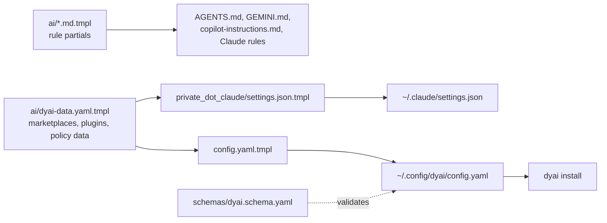

# dyai: idea and architecture

This note explains why `dyai` exists, how its parts fit together, and how
each command works, as of branch `crew` (2026-10-26). It is the overview;
[`dyai.md`](dyai.md) is the reference for commands and config keys.

Status of the pieces described here:

| Part | State |
|---|---|
| Baseline install, per-project presets, `dyai mcp`, LSP sharing | merged into `main` |
| Hardening: time limits, local-edit protection, model tiers, `dyai status`, `dyai enforcement`, subagent spawn log | built on `crew` |
| Crew: run, review, fix and merge tasks across agent CLIs | planned on `crew`, not built ([plan](superpowers/plans/2026-10-26-dyai-crew.md)) |

<!-- toc -->

- [The idea](#the-idea)
- [Three layers of config](#three-layers-of-config)
- [Where the config comes from](#where-the-config-comes-from)
- [Commands](#commands)
- [`dyai install`: the baseline](#dyai-install-the-baseline)
  - [One concept, seven dialects](#one-concept-seven-dialects)
- [`dyai use`: per-project presets](#dyai-use-per-project-presets)
- [Runtime pieces every session shares](#runtime-pieces-every-session-shares)
- [Honesty: what dyai checks about itself](#honesty-what-dyai-checks-about-itself)
- [Crew: several agents on one task (planned)](#crew-several-agents-on-one-task-planned)
- [Known limits](#known-limits)
- [File map](#file-map)
- [Tests](#tests)

<!-- tocstop -->

## The idea

This machine runs seven AI-agent CLIs: Claude Code, Codex, Gemini CLI,
opencode, GitHub Copilot CLI, Antigravity (`agy`) and Hermes. Each one has its
own way to declare skills, subagents, MCP servers, plugins, hooks and
permissions, in its own file format and its own directory. Kept by hand, they
drift: a rule added to Claude never reaches Codex, an MCP server works in one
agent and is missing in the next, a skill is installed twice.

`dyai` treats agent extensions the way `mise` treats tools:

- **One declarative config** describes what every agent should have.
- **`dyai install` converges** each installed agent onto it. It is idempotent:
  run it again and nothing changes. An agent whose CLI is absent is skipped.
- **A small global baseline** loads into every session; everything
  domain-specific lives in a **registry of presets** that a project opts into
  with `dyai use <name>`. Context is a budget: every global skill description
  and MCP tool definition is paid for in every session.
- **Personal by default.** Per-project choices are written to git's personal
  ignore (`.git/info/exclude`), never to a committed file, so they never reach
  the team.
- **Translate, don't copy.** dyai keeps one concept (a deny rule, a stop
  hook, an MCP server) and writes it into each agent's own mechanism. Where an
  agent has no such mechanism, dyai says so instead of pretending.

## Three layers of config

```text
~/.config/dyai/config.yaml
├── global        baseline for every agent, every project
│   ├── skills        skills.sh entries (cross-cutting only)
│   ├── subagents     pinned repo + categories, optional exclude and models
│   ├── commands      pinned repos of command .md files (presets name them)
│   ├── mcp           servers, written into every MCP-capable agent
│   ├── hooks         abstract events: stop, input
│   ├── installers    one shell command per agent id, run once per hash
│   ├── policy        permissions (Claude syntax), approval mode, theme, effort
│   └── lsp           which Neovim language servers to share, serena pin
├── agents.<name> things only one agent understands
│   └── claude        marketplaces, plugins, optional_plugins, model_tiers
└── registry      opt-in presets: languages, infra, presets
                  each {subagents?, skills?, mcp?, commands?, plugins?}
```

A project adds a fourth, personal layer: `.dyai.toml` at the repository root,
holding `use = [...]` (chosen presets) and the manifest of files dyai wrote
for them.

## Where the config comes from

Everything is rendered by chezmoi from this repository:



- `home/.chezmoitemplates/ai/dyai-data.yaml.tmpl` is data only. Both the dyai
  config and Claude's `settings.json` render from it, so the two never drift.
- `schemas/dyai.schema.yaml` validates the rendered config
  (`additionalProperties: false` throughout).
- The machine-wide agent rules (credentials, destructive commands, intent,
  verification, …) are separate partials in `home/.chezmoitemplates/ai/`,
  rendered into each agent's instruction file. They are the soft half of the
  policy; `global.policy.permissions` is the half a harness can enforce.
- `home/.chezmoiscripts/run_onchange_after_03-setup-ai.sh.tmpl` runs
  `dyai install` on `chezmoi apply` when the inputs change.

## Commands

| Command | Scope | What it does |
|---|---|---|
| `dyai install` | machine | Converge every installed agent onto `global` and `agents.*` |
| `dyai use <name>` | project | Record a preset in `.dyai.toml` and materialize it |
| `dyai ls` | project | Print the baseline, the registry and this project's presets |
| `dyai rm <name>` | project | Drop a preset and prune exactly the files it owned |
| `dyai mcp` | session | Serve `ls`, `use`, `rm` as MCP tools on stdio |
| `dyai status [--quiet]` | machine | Report drift between the config and each agent |
| `dyai enforcement` | — | Print what each agent actually enforces |

The CLI is `home/dot_local/bin/executable_dyai.tmpl`, a thin dybatpho
`opts` front end. The logic lives in sourced libraries under `scripts/lib/`,
each with a bats file under `scripts/test/`.

## `dyai install`: the baseline

`dyai::install` needs `jq`, `yq` and the config, then runs these steps in
order. A step that fails warns and the install carries on; one broken item
never stops the rest.

1. **LSP** (`dyai_lsp::setup`): export Neovim's configured language servers
   into a manifest and hand them to every agent (see below). It runs first
   because it registers the local `dyai-lsp` marketplace that step 3 installs
   from.
2. **Marketplaces** (Claude): `claude plugin marketplace add` for each one
   not yet known.
3. **Plugins** (Claude): `claude plugin install` for each one not in
   `installed_plugins.json`. `optional_plugins` install too but stay switched
   off in `settings.json` until a preset turns them on.
4. **MCP**: each `global.mcp` server is written into every MCP-capable agent
   in its own format (`claude mcp add-json` across every Claude config
   directory, JSON merges for Gemini/agy/Copilot/opencode, TOML for Codex,
   YAML for Hermes). Claude skips a server that an enabled plugin of the same
   name already bundles. `env` holds variable names, never values.
5. **Gemini baseline**: fixed settings (schema, context file names,
   checkpointing, telemetry off, `security.disableYoloMode`).
6. **Policy**: the approval mode (`accept-edits`) mapped per agent.
7. **Permissions**: `Bash(...)`, `Read(...)`, `Edit(...)` rules translated
   per agent (table below).
8. **Hooks**: the abstract `stop` and `input` events written as Gemini
   `AfterAgent`, Copilot `hooks/dyai.json`, Codex `hooks.Stop`, and so on.
9. **Subagents**: the pinned VoltAgent categories copied into
   `~/.claude/agents`, and converted to TOML for `~/.codex/agents` (an agent
   with no writing tool runs `read-only` there).
10. **Skills**: `skills add <entry> -g` for each missing global skill.
11. **Installers**: each `global.installers` command, once per content hash.

Every external command in steps 2, 3, 10 and 11 goes through
`dyai::run_external`: stdin closed, killed after `DYAI_EXTERNAL_TIMEOUT`
(300 s by default). A skill or plugin that reports success is then checked
by path; "exit 0 but nothing installed" is a warning, not a success.

### One concept, seven dialects

| Concept | Claude | Codex | Gemini | opencode | Copilot | agy | Hermes |
|---|---|---|---|---|---|---|---|
| Shell deny/ask | `permissions` | `rules/dyai.rules` `prefix_rule` | `policies/dyai.toml` | `permission.bash` globs | none | `command(<prefix>)` | `approvals.deny` (deny only) |
| Path rules | `permissions` | instructions only | instructions only | `permission.read/edit` | instructions only | none | none |
| Stop hook | `settings.json` | `hooks.Stop` | `AfterAgent` | (hunk plugin) | `hooks/dyai.json` | none | none |
| Subagents | `~/.claude/agents/*.md` | `~/.codex/agents/*.toml` | none | none | none | none | none |
| LSP | `dyai-lsp` plugin | serena MCP | serena MCP | native config | native config | serena MCP | native config |

Gemini, Codex and agy match literal prefixes, so a rule with an inner `*` is
not written for them, and dyai warns. `dyai enforcement` prints this as an
`M` / `S` / `-` table (mechanical, instructions-only, not carried), embedded
in [`dyai.md`](dyai.md#permissions-in-other-agents).

## `dyai use`: per-project presets

```text
dyai use go
  ├─ resolve "go" across registry.languages / infra / presets (ambiguous → error)
  ├─ append to .dyai.toml use = [...]; add /.dyai.toml to .git/info/exclude
  └─ materialize every preset in use:
       subagents → ./.claude/agents/<name>.md   (from the pinned repo)
       commands  → ./.claude/commands/<name>.md
       skills    → ./.agents/skills/<leaf>      (skills add, no -g)
       mcp       → Claude project-local scope   (not the shared .mcp.json)
       plugins   → ./.claude/settings.local.json enabledPlugins
     then record the manifest and personal-ignore every path it wrote
```

`dyai rm` and any re-run prune files no preset wants any more. Pruning is
confined to the three project subtrees, refuses traversal segments, and is
skipped entirely when a subagent source could not be fetched. A crafted
`.dyai.toml` therefore cannot turn it into an arbitrary delete, and being
offline cannot wipe files dyai could not recompute.

`dyai mcp` exposes `ls`, `use` and `rm` as MCP tools, so an agent can pull a
preset in by itself. It is registered in `global.mcp`, so every agent has it.

## Runtime pieces every session shares

- **Shared MCP backends** (`mcp_share.sh`, `laya_mcp.sh`, `dybrain-mcp`).
  Every agent session normally starts its own copy of each MCP server. For a
  heavy one, a thin per-session launcher instead talks to one shared backend:
  `laya` keeps a single loopback `laya-serve` (its checkpoints are about
  3.4 GB), and `dybrain` keeps one vault server on an owner-only Unix socket.
- **LSP sharing** (`dyai_lsp.sh`, `dyai_lsp_export.lua`). Headless Neovim
  lists its configured servers minus `global.lsp.exclude`; each agent gets
  them in its own form (table above). Every server command goes through
  `dyai-lsp-exec`, a trust gate: inside a directory Neovim holds untrusted
  (`.worktrees/dyreview-*`), the server is refused.
- **`dyai-hunk`** (`dyai_hunk.sh`). Every agent's stop hook opens
  `hunk diff --watch` for the checkout it worked in, once per checkout, so
  the user sees each agent's changes side by side.

## Honesty: what dyai checks about itself

The hardening work on this branch is about dyai never claiming more than it
did. Each item answers one way a silent failure used to look like success.

| Failure that used to be silent | What dyai does now |
|---|---|
| An installer hangs on a prompt or network | `run_external`: stdin closed, time limit, the install continues |
| A skills CLI exits 0 but installs nothing | Checked by path after install; warns with the missing target |
| `dyai install` overwrites a subagent you edited | Content hash recorded at install (`~/.cache/dyai/installed/<kind>/<name>.sha256`). An edited file is kept with a `LOCAL EDITS` warning. A file with no hash yet is backed up to `<file>.dyai-bak` before it is replaced |
| A subagent runs on the wrong model for its job | `global.subagents[].models` gives an abstract tier (`fast`, `standard`, `strong`, `inherit`); each agent maps it through `agents.<name>.model_tiers` (Claude: haiku / sonnet / opus). Shared config never carries one agent's model names |
| The machine drifts from the config unnoticed | `dyai status` compares skills, plugins, subagents, MCP, hooks and policy for every installed agent. Claude runs it at session start; drift appears to the user as a `systemMessage`, and a clean machine prints nothing |
| Docs claim an agent enforces a rule it does not | `dyai enforcement` table, with two tests: the docs block must equal the command output, and every approval/shell/path cell must match what the permission writers actually produce for a probe rule |
| Subagent use is invisible | `log-agent.sh` (Claude PreToolUse on `Agent`/`Task`) appends type, model and description to `~/.local/state/claude/agent-usage.jsonl`. It only observes: no output, always exit 0 |
| A security change reviewed by its own author | The `verification` rule asks for a fresh reviewer on security paths, and proof that reverting the fix makes its test fail |

## Crew: several agents on one task (planned)

Not built yet; the design is in
[`2026-10-26-dyai-crew.md`](superpowers/plans/2026-10-26-dyai-crew.md). The idea:
use the agents dyai already configured as a crew, without dyai ever calling a
provider API itself. Every worker is the real CLI in headless mode, so it
keeps the skills, MCP servers and policy `dyai install` gave it. dyai holds no
LLM: a human or a lead agent decides what to run.

```text
dyai run "task"          worktree .worktrees/crew-<id> on branch crew/<id>
   │                     agent CLI, headless, prompt on stdin, DYAI_CREW=<id>
   │                     result file + evidence check + orchestrator commit
   │                     rate limit or auth failure → next agent in fallback
   ▼
dyai review <id>         a different provider, read-only, verdict JSON
   │  fail ──► dyai fix <id> ──► dyai review <id>
   ▼  pass on the current head
dyai merge <id>          integration branch only, fences, --no-ff --no-commit,
                         gate command, then commit and drop the worktree
```

The rails that matter most:

- **Evidence over claims.** A task is `done` only with a valid result file,
  commits on `base..crew/<id>`, and the branch still `crew/<id>`. An agent
  that claims done with no change is `failed`.
- **Cross-provider review gates the merge.** The verdict is parsed from each
  agent's real output envelope; anything unparsable is `unknown`, and
  `unknown` never passes. A new commit after review voids the verdict.
- **Fences.** A diff touching `.github/`, `.chezmoiscripts/`, `secrets/`,
  `*.age` or `.env*` is never merged automatically.
- **No prompt in argv.** The 128 KiB per-argument limit would break a review
  prompt that carries a diff; prompts travel on stdin or as a file.
- **Clean up worktrees.** Each registered worktree enlarges Claude Code's
  sandbox profile; past about 18 of them every Bash call fails with `E2BIG`.
- **`dyai selftest` and `dyai eval`** turn the enforcement table and the
  agent rules into live checks: a probe command the policy must deny, and
  seeded cases such as "never read `secrets/data/`".

What was checked on 2026-10-26: claude and copilot answer headless on this
machine; codex (local proxy 401), gemini (not signed in) and opencode (no key
for its default provider) are `BLOCKED` until they are set up. The plan keeps
a per-agent facts table and marks which cells were verified live.

## Known limits

- Path rules reach only Claude and opencode. For the other agents the
  credential-store rules rest on instruction text (`S` in the table).
- Copilot has no user-level config key for denied tools, so dyai writes no
  shell rules for it.
- The LSP trust gate checks only the directory a server starts in.
- Skills are never updated once installed; the recorded hashes are the base
  for a future update check.
- Every worker and every session pays for the whole global setup in context
  (a one-line headless Claude answer loaded about 46k tokens). Keeping the
  baseline lean is the only lever today.

## File map

| Path | Role |
|---|---|
| `home/dot_local/bin/executable_dyai.tmpl` | CLI entry (dybatpho opts) |
| `scripts/lib/dyai.sh` | install, use/ls/rm, materialize, permissions, hooks, subagents, hashes, enforcement table |
| `scripts/lib/dyai_status.sh` | drift report |
| `scripts/lib/dyai_mcp.sh` | `dyai mcp` stdio server |
| `scripts/lib/dyai_lsp.sh`, `dyai_lsp_export.lua`, `dyai_lsp_exec.sh` | LSP export, per-agent config, trust gate |
| `scripts/lib/dyai_hunk.sh` | stop-hook diff viewer |
| `scripts/lib/mcp_share.sh`, `scripts/lib/laya_mcp.sh` | shared MCP backends |
| `home/private_dot_config/dyai/config.yaml.tmpl` | the config |
| `home/.chezmoitemplates/ai/dyai-data.yaml.tmpl` | data shared with Claude's settings |
| `home/.chezmoitemplates/ai/*.md.tmpl` | agent rules rendered into every instruction file |
| `schemas/dyai.schema.yaml` | config schema |
| `home/private_dot_claude/hooks/executable_log-agent.sh` | subagent spawn log |
| `home/.chezmoiscripts/run_onchange_after_03-setup-ai.sh.tmpl` | runs `dyai install` on apply |

## Tests

One bats file per library: `dyai.bats`, `dyai_status.bats`, `dyai_mcp.bats`,
`dyai_lsp.bats`, `dyai_lsp_exec.bats`, `dyai_hunk.bats`, `mcp_share.bats`,
`laya_mcp.bats`, plus `dyai_schema.bats` (schema and rendered config),
`claude_settings.bats` (rendered settings against a fixture) and
`claude_hooks.bats`. Agent CLIs are stubs on `PATH`; tests that check
"installed agents only" link `jq` and `yq` one by one so a real agent CLI on
the developer's machine never leaks in. Run them with:

```bash
./scripts/test.sh --all     # whole suite
./scripts/test.sh --dyai    # dyai config against its schema
```
