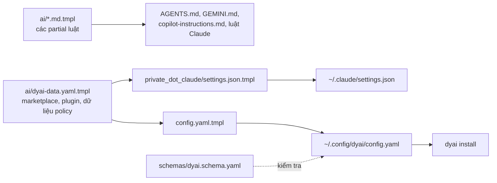

# dyai: ý tưởng và kiến trúc

Tài liệu này giải thích vì sao có `dyai`, các phần của nó ghép với nhau ra
sao và từng lệnh chạy thế nào, tính đến nhánh `crew` (2026-10-27). Đây là bản
tiếng Việt của [`dyai-architecture.md`](dyai-architecture.md); khi hai bản
lệch nhau, bản tiếng Anh là bản gốc. Tra cứu lệnh và khoá cấu hình xem
[`dyai.md`](dyai.md).

Trạng thái các phần được mô tả:

| Phần | Trạng thái |
|---|---|
| Cài baseline, preset theo dự án, `dyai mcp`, chia sẻ LSP | đã merge vào `main` |
| Hardening: giới hạn thời gian, bảo vệ sửa cục bộ, model tier, `dyai status`, `dyai enforcement`, log spawn subagent | đã làm trên `crew` |
| Crew: chạy, review, sửa và merge task qua các CLI agent, worker gọn (lean), tool crew trong MCP, `selftest`, `eval` | đã làm trên `crew` ([kế hoạch](superpowers/plans/2026-10-26-dyai-crew.md)), đã review, chưa merge |
| Subagent cho Gemini, opencode, Copilot; `dyai update` (skill theo hash); cổng routing; hiển thị qua zellij | đã làm trên `crew` |

<!-- toc -->

- [Ý tưởng](#ý-tưởng)
- [Ba lớp cấu hình](#ba-lớp-cấu-hình)
- [Cấu hình đến từ đâu](#cấu-hình-đến-từ-đâu)
- [Các lệnh](#các-lệnh)
- [`dyai install`: baseline](#dyai-install-baseline)
  - [Một khái niệm, bảy phương ngữ](#một-khái-niệm-bảy-phương-ngữ)
- [`dyai use`: preset theo dự án](#dyai-use-preset-theo-dự-án)
- [Những phần chạy chung cho mọi phiên](#những-phần-chạy-chung-cho-mọi-phiên)
- [Trung thực: dyai tự kiểm tra những gì](#trung-thực-dyai-tự-kiểm-tra-những-gì)
- [Crew: nhiều agent trên một task](#crew-nhiều-agent-trên-một-task)
- [Review cuối đã tìm ra và sửa gì](#review-cuối-đã-tìm-ra-và-sửa-gì)
- [Điểm còn tồn đọng](#điểm-còn-tồn-đọng)
- [Bản đồ file](#bản-đồ-file)
- [Test](#test)

<!-- tocstop -->

## Ý tưởng

Máy này chạy bảy CLI agent AI: Claude Code, Codex, Gemini CLI, opencode,
GitHub Copilot CLI, Antigravity (`agy`) và Hermes. Mỗi cái có cách riêng để
khai báo skill, subagent, MCP server, plugin, hook và quyền, với định dạng
file và thư mục riêng. Giữ bằng tay thì chúng lệch nhau: một luật thêm cho
Claude không tới Codex, một MCP server chạy ở agent này mà thiếu ở agent kia,
một skill bị cài hai lần.

`dyai` đối xử với phần mở rộng của agent như `mise` đối xử với tool:

- **Một cấu hình khai báo** mô tả mọi agent cần có gì.
- **`dyai install` hội tụ** từng agent đã cài về cấu hình đó. Chạy lại không
  đổi gì (idempotent). Agent nào không có CLI thì bỏ qua.
- **Baseline toàn cục nhỏ** nạp vào mọi phiên; mọi thứ theo lĩnh vực nằm
  trong **registry preset** mà dự án chọn bằng `dyai use <tên>`. Context là
  ngân sách: mỗi mô tả skill và định nghĩa tool MCP toàn cục đều tốn chỗ ở
  mọi phiên.
- **Mặc định là cá nhân.** Lựa chọn theo dự án ghi vào ignore cá nhân của git
  (`.git/info/exclude`), không bao giờ vào file được commit, nên không tới
  team.
- **Dịch, không chép.** dyai giữ một khái niệm (một luật deny, một stop hook,
  một MCP server) và ghi nó vào cơ chế riêng của từng agent. Agent nào không có
  cơ chế đó thì dyai nói rõ, không giả vờ.

## Ba lớp cấu hình

```text
~/.config/dyai/config.yaml
├── global        baseline cho mọi agent, mọi dự án
│   ├── skills        mục skills.sh (chỉ loại dùng chung)
│   ├── subagents     repo ghim + category, exclude và models tuỳ chọn
│   ├── commands      repo ghim chứa file lệnh .md (preset gọi tên)
│   ├── mcp           server, ghi vào mọi agent hỗ trợ MCP
│   ├── hooks         sự kiện trừu tượng: stop, input
│   ├── installers    một lệnh shell cho mỗi agent, chạy một lần theo hash
│   ├── policy        quyền (cú pháp Claude), approval mode, theme, effort
│   ├── lsp           language server nào của Neovim được chia sẻ, ghim serena
│   └── crew          fallback, reviewer, model, timeout, fences, gate, profile, panes
├── agents.<tên>  thứ chỉ một agent hiểu
│   └── claude        marketplaces, plugins, optional_plugins, model_tiers
└── registry      preset tự chọn: languages, infra, presets
                  mỗi cái {subagents?, skills?, mcp?, commands?, plugins?}
```

Dự án thêm lớp thứ tư, cá nhân: `.dyai.toml` ở gốc repo, chứa
`use = [...]` (preset đã chọn) và danh sách file dyai đã ghi cho chúng.

## Cấu hình đến từ đâu

Mọi thứ do chezmoi render từ repo này:



- `home/.chezmoitemplates/ai/dyai-data.yaml.tmpl` chỉ chứa dữ liệu. Cả cấu
  hình dyai và `settings.json` của Claude render từ nó, nên hai cái không lệch.
- `schemas/dyai.schema.yaml` kiểm tra cấu hình đã render
  (`additionalProperties: false` ở mọi chỗ).
- Luật agent toàn máy (credential, lệnh phá huỷ, intent, verification, …) là
  các partial riêng trong `home/.chezmoitemplates/ai/`, render vào file hướng
  dẫn của từng agent. Đó là nửa "mềm" của policy; `global.policy.permissions`
  là nửa mà harness có thể ép buộc.
- `home/.chezmoiscripts/run_onchange_after_03-setup-ai.sh.tmpl` chạy
  `dyai install` khi `chezmoi apply` thấy đầu vào đổi.

## Các lệnh

| Lệnh | Phạm vi | Làm gì |
|---|---|---|
| `dyai install` | máy | Hội tụ mọi agent đã cài về `global` và `agents.*` |
| `dyai use <tên>` | dự án | Ghi preset vào `.dyai.toml` và tạo file cho nó |
| `dyai ls` | dự án | In baseline, registry và preset của dự án |
| `dyai rm <tên>` | dự án | Bỏ preset và xoá đúng các file nó sở hữu |
| `dyai mcp` | phiên | Phục vụ `ls`, `use`, `rm` và tool crew dưới dạng MCP qua stdio |
| `dyai status [--quiet]` | máy | Báo lệch giữa cấu hình và từng agent |
| `dyai enforcement` | — | In thứ mỗi agent thực sự ép buộc |
| `dyai update [--check]` | máy | Cập nhật skill đã cài khi upstream đổi; giữ chỗ bạn tự sửa |
| `dyai run`, `tasks`, `logs`, `review`, `fix`, `merge`, `drop` | repo | Crew (bên dưới) |
| `dyai selftest [AGENT...]`, `dyai eval` | máy | Kiểm tra sống policy và luật agent (tốn quota) |

Option luôn đứng trước đối số vị trí (`dyai review --by copilot ID`): bộ
parse của dybatpho ngừng đọc option ở đối số đầu tiên.

CLI là `home/dot_local/bin/executable_dyai.tmpl`, một front end mỏng dùng
`opts` của dybatpho. Logic nằm trong các thư viện được source ở
`scripts/lib/`, mỗi cái có file bats trong `scripts/test/`.

## `dyai install`: baseline

`dyai::install` cần `jq`, `yq` và cấu hình, rồi chạy các bước theo thứ tự.
Bước nào lỗi thì cảnh báo và đi tiếp; một mục hỏng không chặn phần còn lại.

1. **LSP** (`dyai_lsp::setup`): xuất các language server Neovim đã cấu hình ra
   manifest và đưa cho mọi agent. Chạy đầu tiên vì nó đăng ký marketplace cục
   bộ `dyai-lsp` mà bước 3 cài từ đó.
2. **Marketplace** (Claude): `claude plugin marketplace add` cho cái chưa có.
3. **Plugin** (Claude): `claude plugin install` cho cái chưa có trong
   `installed_plugins.json`. `optional_plugins` cũng được cài nhưng tắt trong
   `settings.json` cho tới khi preset bật.
4. **MCP**: mỗi server trong `global.mcp` ghi vào mọi agent hỗ trợ MCP theo
   định dạng riêng (`claude mcp add-json` cho mọi thư mục cấu hình Claude,
   merge JSON cho Gemini/agy/Copilot/opencode, TOML cho Codex, YAML cho
   Hermes). Claude bỏ qua server trùng tên với server mà một plugin đang bật
   đã mang theo. `env` chứa tên biến, không bao giờ chứa giá trị.
5. **Baseline Gemini**: các thiết lập cố định (schema, tên file context,
   checkpoint, tắt telemetry, `security.disableYoloMode`).
6. **Policy**: approval mode (`accept-edits`) ánh xạ cho từng agent.
7. **Quyền**: luật `Bash(...)`, `Read(...)`, `Edit(...)` dịch cho từng agent
   (bảng dưới).
8. **Hook**: sự kiện trừu tượng `stop` và `input` ghi thành `AfterAgent` của
   Gemini, `hooks/dyai.json` của Copilot, `hooks.Stop` của Codex, v.v.
9. **Subagent**: các category VoltAgent đã ghim được chép vào
   `~/.claude/agents`, chuyển sang TOML cho `~/.codex/agents` (agent không có
   tool ghi thì chạy `read-only`), và sang agent Markdown cho Gemini
   (`~/.gemini/agents`), opencode (`~/.config/opencode/agents`) và Copilot
   (`~/.copilot/agents/*.agent.md`). File dyai không cần nữa chỉ bị xoá khi
   vẫn khớp hash dyai đã ghi.
10. **Skill**: `skills add <mục> -g` cho skill toàn cục còn thiếu.
11. **Installer**: mỗi lệnh trong `global.installers`, một lần theo hash nội
    dung.

Mọi lệnh ngoài ở bước 2, 3, 10 và 11 đi qua `dyai::run_external`: đóng stdin,
bị kill sau `DYAI_EXTERNAL_TIMEOUT` (mặc định 300 s). Skill hay plugin báo
thành công thì được kiểm tra lại theo đường dẫn; "exit 0 mà không cài gì" là
cảnh báo, không phải thành công.

### Một khái niệm, bảy phương ngữ

| Khái niệm | Claude | Codex | Gemini | opencode | Copilot | agy | Hermes |
|---|---|---|---|---|---|---|---|
| Deny/ask shell | `permissions` | `rules/dyai.rules` `prefix_rule` | `policies/dyai.toml` | glob `permission.bash` | không | `command(<prefix>)` | `approvals.deny` (chỉ deny) |
| Luật đường dẫn | `permissions` | chỉ hướng dẫn | chỉ hướng dẫn | `permission.read/edit` | chỉ hướng dẫn | không | không |
| Stop hook | `settings.json` | `hooks.Stop` | `AfterAgent` | (plugin hunk) | `hooks/dyai.json` | không | không |
| Subagent | `~/.claude/agents/*.md` | `~/.codex/agents/*.toml` | `~/.gemini/agents/*.md` | `opencode/agents/*.md` | `~/.copilot/agents/*.agent.md` | không | không |
| LSP | plugin `dyai-lsp` | serena MCP | serena MCP | cấu hình gốc | cấu hình gốc | serena MCP | cấu hình gốc |

Gemini, Codex và agy khớp tiền tố nguyên văn, nên luật có `*` ở giữa không
được ghi cho chúng, và dyai cảnh báo. `dyai enforcement` in bảng này dạng
`M` / `S` / `-` (cơ học, chỉ hướng dẫn, không mang theo), nhúng trong
[`dyai.md`](dyai.md#permissions-in-other-agents).

## `dyai use`: preset theo dự án

```text
dyai use go
  ├─ tìm "go" trong registry.languages / infra / presets (trùng tên → lỗi)
  ├─ thêm vào .dyai.toml use = [...]; thêm /.dyai.toml vào .git/info/exclude
  └─ tạo file cho mọi preset đang dùng:
       subagents → ./.claude/agents/<tên>.md    (từ repo ghim)
       commands  → ./.claude/commands/<tên>.md
       skills    → ./.agents/skills/<lá>        (skills add, không -g)
       mcp       → phạm vi project-local của Claude (không phải .mcp.json chung)
       plugins   → ./.claude/settings.local.json enabledPlugins
     rồi ghi manifest và ignore cá nhân mọi đường dẫn đã ghi
```

`dyai rm` và mỗi lần chạy lại xoá file không preset nào cần nữa. Việc xoá chỉ
trong ba cây thư mục của dự án, từ chối đoạn `..`, và bỏ qua hẳn khi không
tải được nguồn subagent. Vì vậy một `.dyai.toml` bị chế không thể biến nó
thành lệnh xoá tuỳ ý, và mất mạng cũng không xoá file mà dyai không tính lại
được.

`dyai mcp` đưa `ls`, `use`, `rm` thành tool MCP để agent tự kéo preset vào.
Nó được đăng ký trong `global.mcp`, nên agent nào cũng có.

## Những phần chạy chung cho mọi phiên

- **Backend MCP dùng chung** (`mcp_share.sh`, `laya_mcp.sh`, `dybrain-mcp`).
  Bình thường mỗi phiên agent tự khởi một bản của từng MCP server. Với server
  nặng, một launcher mỏng theo phiên nói chuyện với một backend chung: `laya`
  giữ một `laya-serve` trên loopback (checkpoint khoảng 3.4 GB), `dybrain` giữ
  một server vault trên Unix socket chỉ chủ sở hữu dùng được.
- **Chia sẻ LSP** (`dyai_lsp.sh`, `dyai_lsp_export.lua`). Neovim headless liệt
  kê server đã cấu hình trừ `global.lsp.exclude`; mỗi agent nhận theo dạng
  riêng (bảng trên). Mọi lệnh server đi qua `dyai-lsp-exec`, một cổng tin
  cậy: trong thư mục Neovim coi là không tin cậy (`.worktrees/dyreview-*`)
  thì server bị từ chối.
- **`dyai-hunk`** (`dyai_hunk.sh`). Stop hook của mọi agent mở
  `hunk diff --watch` cho checkout nó vừa làm, mỗi checkout một lần, để người
  dùng thấy thay đổi của từng agent song song. Agent có thể giải thích chỗ
  sửa trong `dyai-hunk.json` ở git dir; cửa sổ hiện nó thành ghi chú.
- **Hiển thị qua zellij** (`dyai_zellij.sh`). Mọi cửa sổ dyai mở (hunk, log
  của worker crew, diff review) đều qua `dyai_zellij::open`: pane nổi khi
  đang trong zellij; ngoài zellij thì một pane trong session nền `dyai`, hiện
  trong một tab kitty nếu chưa có client nào gắn vào; tab kitty thường khi
  zellij lỗi. `DYAI_VIEWS=off` không mở gì (test đặt biến này).
- **Cổng routing** (`route-agent.sh`). Hook PreToolUse của Claude trên
  `Agent|Task` từ chối spawn subagent không chọn model, trừ khi đó là fork,
  định nghĩa của nó ghim `model`, hoặc phiên đã hỏi laya (`laya_route`,
  `laya_decide`) trong 15 phút gần nhất. `DYAI_AGENT_ROUTING=warn` chỉ nhắc,
  `off` tắt, worker crew đi qua. Đầu vào không parse được thì cho qua.

## Trung thực: dyai tự kiểm tra những gì

Phần hardening trên nhánh này nhằm để dyai không bao giờ khai nhiều hơn những
gì nó đã làm. Mỗi mục trả lời một kiểu lỗi im lặng từng trông như thành công.

| Lỗi từng im lặng | dyai giờ làm gì |
|---|---|
| Installer treo chờ prompt hay mạng | `run_external`: đóng stdin, giới hạn thời gian, install đi tiếp |
| CLI skills exit 0 mà không cài gì | Kiểm tra đường dẫn sau khi cài; cảnh báo kèm đích bị thiếu |
| `dyai install` ghi đè subagent bạn đã sửa | Ghi hash nội dung lúc cài (`~/.cache/dyai/installed/<loại>/<tên>.sha256`). File đã sửa được giữ, kèm cảnh báo `LOCAL EDITS`. File chưa có hash được sao lưu thành `<file>.dyai-bak` trước khi thay |
| Subagent chạy sai model so với việc | `global.subagents[].models` cho một tier trừu tượng (`fast`, `standard`, `strong`, `inherit`); mỗi agent ánh xạ qua `agents.<tên>.model_tiers` (Claude: haiku / sonnet / opus). Cấu hình chung không chứa tên model của riêng agent nào |
| Máy lệch khỏi cấu hình mà không ai biết | `dyai status` so skill, plugin, subagent, MCP, hook và policy của mọi agent đã cài. Claude chạy nó lúc mở phiên; lệch hiện cho người dùng thành `systemMessage`, máy sạch thì không in gì |
| Tài liệu nói agent ép buộc một luật mà nó không làm | Bảng `dyai enforcement`, với hai test: khối trong tài liệu phải bằng output của lệnh, và mỗi ô approval/shell/path phải khớp những gì bộ ghi quyền thực sự sinh ra cho một luật thử |
| Không thấy việc dùng subagent | `log-agent.sh` (PreToolUse của Claude trên `Agent`/`Task`) ghi loại, model và mô tả vào `~/.local/state/claude/agent-usage.jsonl`. Chỉ quan sát: không in gì, luôn exit 0 |
| Thay đổi bảo mật do chính tác giả review | Luật `verification` đòi reviewer mới cho đường dẫn bảo mật, và bằng chứng rằng bỏ bản sửa thì test của nó fail |
| Skill cũ dần sau khi cài | `dyai update` cài upstream vào một HOME tạm, so hash, chỉ thay skill bạn chưa sửa (bản sao lưu vào `~/.cache/dyai/backup/skills/`) |
| Bảng policy chỉ được tin, không được thử | `dyai selftest` bảo từng agent chạy một lệnh probe mà luật deny chung cấm |

## Crew: nhiều agent trên một task

dyai dùng các agent nó đã cấu hình như một đội (crew), mà tự nó không bao giờ
gọi API của nhà cung cấp. Mỗi worker là CLI thật ở chế độ headless, nên giữ
nguyên skill, MCP server và policy mà `dyai install` đã cho. dyai không chứa
LLM nào: người dùng hoặc một agent dẫn dắt (qua `dyai mcp`) quyết định chạy gì.

```text
dyai run "task"          worktree .worktrees/crew-<id> trên branch crew/<id>
   │                     CLI agent headless, prompt qua stdin, DYAI_CREW=<id>
   │                     file kết quả + kiểm bằng chứng + dyai tự commit
   │                     rate limit hay lỗi đăng nhập → agent kế trong fallback
   ▼
dyai review <id>         một nhà cung cấp khác, chỉ đọc, verdict JSON
   │  fail ──► dyai fix <id> ──► dyai review <id>
   ▼  pass trên head hiện tại
dyai merge <id>          chỉ vào branch tích hợp, fences, --no-ff --no-commit,
                         lệnh gate, rồi commit và bỏ worktree
```

Trạng thái nằm ở `<checkout chính>/.dyai/crew/` (ignore cá nhân):
`tasks.jsonl` (mỗi thay đổi một dòng, ghi dưới `flock`), và với mỗi task:
prompt, bản sao plan, stdout/stderr, prompt review, diff và câu trả lời.

Từng bước chạy thế nào:

- **Run.** `dyai_crew::cmd` dựng dòng lệnh headless cho từng CLI (claude
  `-p --output-format stream-json`, codex `exec --sandbox workspace-write`,
  gemini `--approval-mode auto_edit`, opencode `run -f`, copilot
  `--output-format json`). Agent chạy trong process group riêng, có giới hạn
  thời gian; Ctrl-C dừng cả nó và ghi `interrupted`. Một pane zellij theo dõi
  log và tự đóng khi agent xong. `--detach` trả về ngay.
- **Bằng chứng hơn lời khai.** Task chỉ `done` khi có `.dyai-result.json`
  hợp lệ, có commit mới trên branch, và branch vẫn là `crew/<id>`. Khai xong
  mà không đổi gì, thiếu file kết quả, hay commit bị hook của bạn từ chối đều
  thành `failed`. `auto` đi theo `global.crew.fallback`, bỏ qua agent đang
  nghỉ sau rate limit hay lỗi đăng nhập.
- **Review.** Một nhà cung cấp khác (`global.crew.reviewer`) nhận task, tóm
  tắt của writer, plan và diff (nhúng thẳng tới 96 kB, lớn hơn thì thành
  file), ở chế độ chỉ đọc. Verdict được đọc từ đúng định dạng output của từng
  CLI; câu trả lời không có verdict, hoặc có hai verdict khác nhau, là
  `unknown`, và `unknown` không bao giờ qua. Review ghi lại commit nó đã xem;
  commit nào sau đó làm verdict mất hiệu lực. Review giữ một lock, nên `drop`
  không rút được worktree khi đang review.
- **Fix.** Sau `fail`, writer chạy lại trong cùng worktree kèm review; nó
  phải tạo commit mới của chính nó.
- **Merge.** Chỉ trên branch tích hợp (không phải `main`/`master`), cây làm
  việc sạch, có `pass` trên head hiện tại. Đường dẫn bị rào (fences) chặn lại
  với trạng thái `needs_human`: `.github/`, `.chezmoiscripts/`, `secrets/`,
  `*.age`, `.env*`, và chính policy của agent: `.claude/`,
  `private_dot_claude/`, `.chezmoitemplates/ai/`, `dyai*.sh`. Nó merge đúng
  commit đã review với `--no-ff --no-commit`, chạy `global.crew.gate` từ thư
  mục gốc, rồi commit.
- **Không đưa dữ liệu lớn qua argv.** Prompt đi qua stdin hoặc file, trạng
  thái task đi vào jq qua stdin, tóm tắt của worker bị cắt còn 500 ký tự:
  một đối số quá 128 KiB sẽ lỗi `E2BIG`.
- **Worker gọn (lean).** `global.crew.profile: lean` (mặc định) chỉ cho
  worker claude nửa policy của settings người dùng và các file luật, không
  plugin, không MCP server: khoảng 29.8k token đầu vào thay vì 57k cho một
  câu trả lời một dòng (đo ngày 2026-10-26). opencode nhận `--pure`, copilot
  nhận `--disable-builtin-mcps`. Không có luật deny thì giữ profile đầy đủ.
- **Từ một agent.** `dyai mcp` phục vụ `crew_run`, `crew_tasks`,
  `crew_review`, `crew_fix`, `crew_merge`, `crew_drop` và `crew_logs`. Id,
  agent và đường dẫn plan đều được kiểm; plan nằm dưới fence hoặc trong
  `.git/` bị từ chối, vì dyai gửi plan cho nhà cung cấp khác.
- **Kiểm tra sống.** `dyai selftest` bảo từng agent chạy
  `dyai-selftest-probe allow` và `deny`, với cờ allow cho phép cả hai, nên chỉ
  luật deny chung mới chặn được lệnh thứ hai; nó cần output của agent cho thấy
  đã thử chạy. `dyai eval` chạy các case dựng sẵn trong
  `scripts/test/evals/` (ví dụ "không bao giờ đọc `secrets/data/`"); case
  fail khi task không kết thúc ở `done`.

Đã chạy thật ngày 2026-10-27: claude làm một task, copilot review `pass`, và
merge thành công, worktree và branch được dọn. codex (proxy cục bộ trả 401),
gemini (chưa đăng nhập) và opencode (provider mặc định chưa có key) vẫn
`BLOCKED` cho tới khi được cài đặt xong.

## Review cuối đã tìm ra và sửa gì

Một reviewer mới đọc toàn bộ nhánh. Mọi mục dưới đây có test hồi quy đã fail
trước khi sửa.

| Phát hiện | Cách sửa |
|---|---|
| Prompt hay trạng thái quá 128 KiB làm chết task và để lại worktree mồ côi | Trạng thái đi qua stdin, tóm tắt bị giới hạn; bỏ luôn một phép cắt chuỗi bậc hai trong bộ đọc log |
| Writer có thể cài `.dyai-review.diff` thành symlink, và review ghi xuyên qua nó ra ngoài sandbox | Xoá đường dẫn đó trước khi ghi diff |
| Plan dưới `secrets/` có thể bị gửi cho nhà cung cấp khác qua MCP `crew_run` | Plan dưới fence hoặc trong `.git/` bị từ chối, cả ở CLI |
| Ctrl-C để agent chạy tiếp tới 30 phút | Dừng cả process group của agent và ghi task `interrupted` |
| `selftest` báo PASS khi agent chỉ bỏ qua lệnh bị cấm | Cần bằng chứng agent đã thử, không thì `BLOCKED` |
| Minor: verdict đầu tiên thắng, merge lấy branch thay vì commit đã review, gate chạy từ thư mục hiện tại, `drop` xoá được task đang chạy, một dòng log hỏng làm mất trạng thái, commit bị từ chối lại báo "claimed done without changes", fix không đổi gì vẫn `done`, hai object trong file kết quả sinh trạng thái hai dòng, eval cho qua task đã bỏ cuộc, selftest ghi vào repo hiện tại, pane log chồng chất, submodule lệch chặn merge, file policy chưa bị rào, task có tiến trình chạy đã chết vẫn `open`, cổng routing chặn subagent đã ghim model | Đã sửa hết, mỗi mục một test |

## Điểm còn tồn đọng

Những điểm này cần quyết định, không chỉ cần code:

- **Copilot làm writer chưa bị kiềm chế.** Nó chạy với `--allow-all-tools`
  (copilot headless không hỏi được), dyai không ghi luật deny nào cho nó, và
  không có sandbox hệ điều hành. Nó đọc được kho credential và ghi được
  `.dyai/crew/tasks.jsonl`, nên có thể giả một verdict `pass`. Hướng xử lý:
  chỉ cho copilot review chỉ đọc (bỏ khỏi `fallback`), cho nó allowlist hẹp,
  hoặc dời trạng thái ra khỏi repo (`$XDG_STATE_HOME`).
- **Review chéo nhà cung cấp mặc định là Claude review Claude.** Reviewer của
  task claude là copilot, mà model mặc định của copilot là Claude. Hãy đặt
  `global.crew.model.copilot` sang model không phải Anthropic, hoặc map claude
  sang codex hay gemini.

Giới hạn đã biết:

- Luật đường dẫn chỉ tới được Claude và opencode. Với agent khác, luật về kho
  credential dựa vào văn bản hướng dẫn (`S` trong bảng).
- Copilot không có khoá cấu hình cấp người dùng cho tool bị cấm, nên dyai
  không ghi luật shell cho nó.
- Cổng tin cậy LSP chỉ kiểm thư mục server khởi động.
- Worker lean chỉ có cho claude, opencode và copilot; codex và gemini chưa có
  cờ đã kiểm chứng nào bỏ plugin mà giữ policy.
- `dyai selftest` và `dyai eval` cần `chezmoi apply` trước (probe và luật deny
  phải có trong `$HOME`), và chưa được chạy thật.
- Cờ CLI của codex, gemini và opencode được kiểm theo tài liệu và help, chưa
  chạy thật trên máy này.
- `dytoy_docs.bats` cũng fail trên `main`: `marktoda/zj-radar` chưa có link
  trong `docs/dytoy.md`. Không liên quan dyai.

## Bản đồ file

| Đường dẫn | Vai trò |
|---|---|
| `home/dot_local/bin/executable_dyai.tmpl` | Điểm vào CLI (opts của dybatpho) |
| `scripts/lib/dyai.sh` | install, use/ls/rm, tạo file, quyền, hook, subagent, hash, `update`, bảng enforcement |
| `scripts/lib/dyai_status.sh` | báo lệch |
| `scripts/lib/dyai_mcp.sh` | server stdio `dyai mcp`, gồm tool crew |
| `scripts/lib/dyai_lsp.sh`, `dyai_lsp_export.lua`, `dyai_lsp_exec.sh` | xuất LSP, cấu hình theo agent, cổng tin cậy |
| `scripts/lib/dyai_hunk.sh` | xem diff khi stop hook chạy |
| `scripts/lib/dyai_zellij.sh` | mọi cửa sổ dyai mở (zellij, dự phòng kitty) |
| `scripts/lib/dyai_crew.sh` | crew: run, review, fix, merge, drop, profile lean, selftest, eval |
| `scripts/lib/mcp_share.sh`, `scripts/lib/laya_mcp.sh` | backend MCP dùng chung |
| `home/private_dot_config/dyai/config.yaml.tmpl` | cấu hình |
| `home/.chezmoitemplates/ai/dyai-data.yaml.tmpl` | dữ liệu chung với settings của Claude |
| `home/.chezmoitemplates/ai/*.md.tmpl` | luật agent render vào mọi file hướng dẫn |
| `schemas/dyai.schema.yaml` | schema cấu hình |
| `home/private_dot_claude/hooks/executable_log-agent.sh` | log spawn subagent |
| `home/private_dot_claude/hooks/executable_route-agent.sh` | cổng routing subagent và ghi lại lần gọi laya |
| `home/dot_local/bin/executable_dyai-selftest-probe` | lệnh probe của selftest |
| `scripts/test/evals/` | các case của `dyai eval` |
| `home/.chezmoiscripts/run_onchange_after_03-setup-ai.sh.tmpl` | chạy `dyai install` khi apply |

## Test

Mỗi thư viện một file bats: `dyai.bats`, `dyai_status.bats`, `dyai_mcp.bats`,
`dyai_crew.bats`, `dyai_zellij.bats`, `dyai_lsp.bats`, `dyai_lsp_exec.bats`,
`dyai_hunk.bats`, `mcp_share.bats`, `laya_mcp.bats`, cùng `dyai_schema.bats`
(schema và cấu hình đã render), `claude_settings.bats` (settings đã render so
với fixture) và `claude_hooks.bats`. CLI agent là stub trên `PATH`; test kiểm
"chỉ agent đã cài" link `jq` và `yq` từng cái một để CLI agent thật trên máy
không lọt vào. Test crew còn chạy trên PATH chỉ gồm stub và tool hệ thống, và
`DYAI_VIEWS=off` giữ mọi test ngoài zellij và kitty của người dùng. Chạy:

```bash
./scripts/test.sh --all     # toàn bộ
./scripts/test.sh --dyai    # cấu hình dyai so với schema
```
